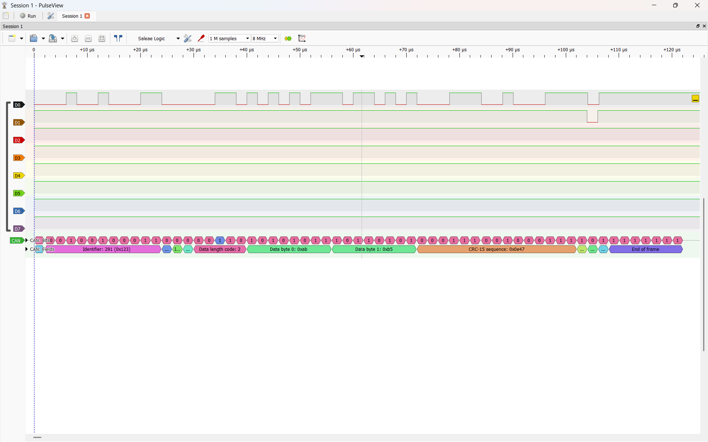
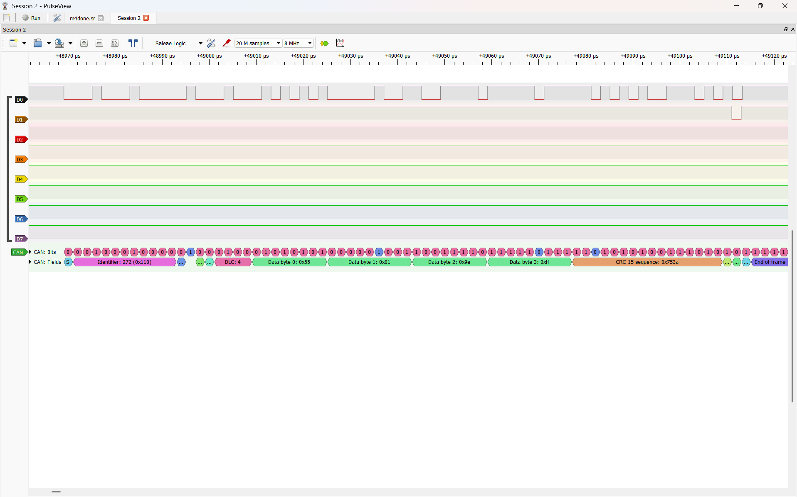

# CAN Gesture-Control Network (ESP32 + STM32)

> **Status: in progress** (started Nov 2026)

A two-node CAN bus built with real transceivers:

- **Node 1 – ESP32** (built-in TWAI/CAN controller): reads an MPU6050 and sends commands on the bus.
- **Node 2 – STM32F103 "Blue Pill"** (bxCAN): receives frames and drives LEDs / reports over UART.
- Bus traffic is captured with a USB logic analyzer and decoded with my
  [protocol-analyzer](https://github.com/imtuaz/protocol-analyzer) (bit destuffing, CRC-15 check).

Later stage: on-device gesture recognition (TinyML) on the ESP32, so a hand gesture
becomes a CAN command.

```
 [Node 1: ESP32 + MPU6050]                 [Node 2: STM32 Blue Pill]
        |  TWAI TX/RX                              |  CAN TX/RX (PB9/PB8)
   [SN65HVD230]                               [SN65HVD230]
        |                                          |
 =======+===== CAN_H / CAN_L (120 ohm at each end) =+=======
                         |
                 [USB logic analyzer] -> PulseView CSV -> protocol-analyzer
```

## Milestones

| # | Goal | Done when | Status |
|---|------|-----------|--------|
| 1 | STM32 blinks, prints over UART | "hello" seen in serial terminal | ✅ |
| 2 | ESP32 TWAI in loopback mode | frame sent and received by itself | ✅ |
| 3 | ESP32 -> STM32 over real bus | STM32 prints received ID + data | ✅ STM32 ACKs every frame (ESP32 TEC = 0); UART print not yet viewed |
| 4 | Capture and decode | logic analyzer CSV decoded by protocol-analyzer, CRC OK | 🟡 decoded in PulseView ([capture](captures/m4_frame_0x123_pulseview.png)); protocol-analyzer pending |
| 5 | Button -> LED over CAN | pressing a button on node 1 toggles an LED on node 2 | ✅ STM32 replies with LED state (0x200), round trip < 1 ms |
| 6 | MPU6050 tilt -> CAN | tilt angle sent every 100 ms | ✅ STM32 LED on at \|roll\| > 30°, off < 25° (hysteresis) |
| 7 | Gesture recognition (TinyML) | ≥ 3 gestures recognized on ESP32 and sent as CAN commands | ☐ |

## CAN message plan

| ID | Sender | DLC | Data | Meaning |
|----|--------|-----|------|---------|
| `0x100` | Node 1 | 1 | LED command (0 = off, 1 = on) | milestone 5 |
| `0x110` | Node 1 | 4 | roll, pitch (int16 little-endian, 0.01°) | milestone 6 |
| `0x120` | Node 1 | 1 | gesture id | milestone 7 |
| `0x200` | Node 2 | 1 | LED state (after 0x100 command, or when tilt crosses threshold) | milestones 5–6 |

Bit rate: **500 kbit/s**.

## First captured frame (milestone 4)



ID `0x123`, DLC 2, data `AB B5`, CRC-15 `0x0E47`. One bit = 2 µs (500 kbit/s), whole frame ≈ 122 µs.
A stuff bit is visible after five consecutive dominant bits (RTR, IDE, r0, first two DLC bits),
and channel D1 (STM32 CAN_TX, PB9) goes dominant for exactly one bit in the ACK slot.

## Tilt frame (milestone 6)



ID `0x110`, DLC 4, data `55 01 9E FF` → roll = 0x0155 = +341 → **+3.41°**, pitch = 0xFF9E = −98 → **−0.98°**.
About 80 bits (4 stuff bits) ≈ 160 µs every 100 ms → bus load ≈ 0.16 %. D1 (STM32 PB9) drives the ACK bit.

## Repository layout

```
docs/       wiring, bill of materials, notes and lessons learned
firmware/
  node1_esp32/   Arduino sketches (ESP-IDF TWAI driver): m2_twai_loopback, m2_twai_loopback_status, m3_can_tx, m5_button_cmd, m6_tilt_tx
  node2_stm32/   bare-metal register-level C (no HAL/SPL): m1_uart_hello, m3_can_rx, m5_led_cmd, m6_tilt_rx
captures/   logic analyzer captures and decoded screenshots
```

See [docs/wiring.md](docs/wiring.md) and [docs/bom.md](docs/bom.md).

## Author

Hồ Anh Tuấn – University of Science, VNU-HCM
