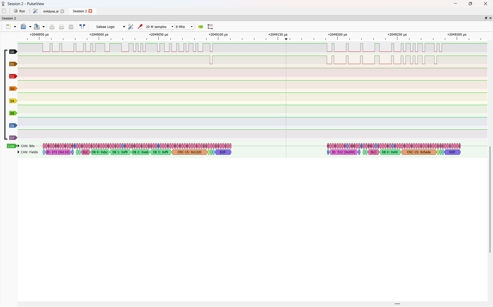

# CAN Gesture-Control Network (ESP32 + STM32)

> **Status: in progress** (started Nov 2026)

A two-node CAN bus built with real transceivers:

- **Node 1 – ESP32** (built-in TWAI/CAN controller): reads an MPU6050 and sends commands on the bus.
- **Node 2 – STM32F103 "Blue Pill"** (bxCAN): receives frames and drives LEDs / reports over UART.
- Bus traffic is captured with a USB logic analyzer and decoded with my
  [protocol-analyzer](https://github.com/imtuaz/protocol-analyzer) (bit destuffing, CRC-15 check).

Later stage: on-device gesture recognition (TinyML) on the ESP32, so a hand gesture
becomes a CAN command.

```
 [Node 1: ESP32 + MPU6050]                 [Node 2: STM32 Blue Pill]
        |  TWAI TX/RX                              |  CAN TX/RX (PB9/PB8)
   [SN65HVD230]                               [SN65HVD230]
        |                                          |
 =======+===== CAN_H / CAN_L (120 ohm at each end) =+=======
                         |
                 [USB logic analyzer] -> PulseView CSV -> protocol-analyzer
```

## Milestones

| # | Goal | Done when | Status |
|---|------|-----------|--------|
| 1 | STM32 blinks, prints over UART | "hello" seen in serial terminal | ✅ |
| 2 | ESP32 TWAI in loopback mode | frame sent and received by itself | ✅ |
| 3 | ESP32 -> STM32 over real bus | STM32 prints received ID + data | ✅ STM32 prints ID + data over UART, its own TEC = REC = 0 ([log](captures/m3_stm32_uart_log.png)) |
| 4 | Capture and decode | logic analyzer CSV decoded by protocol-analyzer, CRC OK | ✅ 30 frames decoded by [protocol-analyzer](https://github.com/imtuaz/protocol-analyzer), 0 errors, matches PulseView |
| 5 | Button -> LED over CAN | pressing a button on node 1 toggles an LED on node 2 | ✅ STM32 replies with LED state (0x200), round trip < 1 ms |
| 6 | MPU6050 tilt -> CAN | tilt angle sent every 100 ms | ✅ STM32 LED on at \|roll\| > 30°, off < 25° (hysteresis) |
| 7 | Gesture recognition (TinyML) | ≥ 3 gestures recognized on ESP32 and sent as CAN commands | ✅ end-to-end over CAN; 90.8 % on an unseen wearing session, live results below |
| 8 | Fault detection and handling | injected faults detected, safe state entered and recovered ([test plan](docs/fault_tests.md)) | ✅ 10 faults tested on hardware; bus-off recovery 2.9–3.1 ms (theory 2.816 ms); found and fixed stale frames after bus-off / lost ACK |

## CAN message plan

| ID | Sender | DLC | Data | Meaning |
|----|--------|-----|------|---------|
| `0x100` | Node 1 | 1 | LED command (0 = off, 1 = on) | milestone 5 |
| `0x110` | Node 1 | 4 | roll, pitch (int16 little-endian, 0.01°) | milestone 6 |
| `0x120` | Node 1 | 2 | gesture id (1 right, 2 left, 3 rotate), confidence % | milestone 7 |
| `0x200` | Node 2 | 1 | LED state (after 0x100 command, or when tilt crosses threshold) | milestones 5–6 |
| `0x110` | Node 1 | 6 | roll, pitch, alive counter (4 bit), CRC-8 SAE J1850 over ID + bytes 0..4 | milestone 8 |
| `0x7E0` | Node 1 | 1 | test command for node 2 ('h' hang, 's' stop 0x210, 'n' resume) | milestone 8 |
| `0x210` | Node 2 | 4 | state (0 normal, 1 degraded, 2 safe), TEC, REC, fault flags; every 100 ms | milestone 8 |

Bit rate: **500 kbit/s**.

## First captured frame (milestone 4)


ID `0x123`, DLC 2, data `AB B5`, CRC-15 `0x0E47`. One bit = 2 µs (500 kbit/s), whole frame ≈ 122 µs.
A stuff bit is visible after five consecutive dominant bits (RTR, IDE, r0, first two DLC bits),
and channel D1 (STM32 CAN_TX, PB9) goes dominant for exactly one bit in the ACK slot.

## Tilt frame (milestone 6)


ID `0x110`, DLC 4, data `55 01 9E FF` → roll = 0x0155 = +341 → **+3.41°**, pitch = 0xFF9E = −98 → **−0.98°**.
About 80 bits (4 stuff bits) ≈ 160 µs every 100 ms → bus load ≈ 0.16 %. D1 (STM32 PB9) drives the ACK bit.

### Command and reply on the same bus



0x110 data `BC F9 AB F9` → roll = 0xF9BC = −1604 → **−16.04°** (below the 25° off-threshold), so the STM32
turns the LED off and answers with 0x200 data `00`. The reply starts about **70 µs** after the 0x110 frame ends.
D1 (STM32 TX) is silent during 0x110 except for the ACK bit, and carries the whole 0x200 frame;
in 0x200 the ACK bit appears on D0 only, driven by the ESP32 ([zoom](captures/m6_frame_0x200_pulseview.png)).

## Decoding with my own protocol-analyzer (milestone 4)

The PulseView captures (`captures/*.sr`) are converted to CSV with [`tools/sr2csv.py`](tools/sr2csv.py)
(a `.sr` file is a zip: metadata + raw samples, 1 byte per sample) and decoded by
[protocol-analyzer](https://github.com/imtuaz/protocol-analyzer), my C99 decoder:

```bash
python tools/sr2csv.py captures/m6_tilt_2500ms.sr m6.csv
pa analyze m6.csv can --bitrate 500000 --report report.html
```
```
  48.969 ms    CAN   FRAME   ID 110   -   ID 0x110 DLC 4 | data 55 01 9E FF
  448.964 ms   CAN   FRAME   ID 110   -   ID 0x110 DLC 4 | data 7A 13 C7 01
  449.199 ms   CAN   FRAME   ID 200   -   ID 0x200 DLC 1 | data 01
  ...
  2.0490 s     CAN   FRAME   ID 110   -   ID 0x110 DLC 4 | data BC F9 AB F9
  2.0492 s     CAN   FRAME   ID 200   -   ID 0x200 DLC 1 | data 00
  29 events, 0 with errors
```
- 2.5 s capture: 25 tilt frames (one every 100 ms) + 4 STM32 replies, all CRC-15 valid
  ([HTML report](captures/m6_tilt_2500ms_report.html)). Single-frame capture: 0x123, data AB B5.
- Two independent decoders (PulseView's and mine) give the same IDs, data and CRC.
- Every reply matches the STM32 hysteresis: roll 0x137A = 49.86° → LED on (`01`),
  roll 19.40° → off, −72.52° → on, −16.04° → off.
- The single-frame capture was triggered on the SOF edge, so its first sample is already dominant;
  `--pad-idle-us 30` prepends idle bus so the decoder can find SOF.

## Gesture recognition (milestone 7)

MPU6050 taped to the back of the hand (±4 g, ±1000 °/s, 100 Hz). Gestures: flick right, flick left,
rotate the wrist, and idle (ordinary movements such as scratching the head or picking up a cup).

**Pipeline**
1. Window capture (same code for data collection and live use): the ESP32 keeps the last 100 samples in a
   ring buffer; when rotation exceeds 100 °/s it takes 30 samples before + 70 after (1 s).
2. Features: mean, std, min, max of 6 axes, computed separately for the first and second half of the window
   → 48 values (the split tells the model which phase of the motion came first).
3. MLP 48-16-4 (ReLU), 852 parameters, trained with scikit-learn (`train.py`), exported to `gesture_model.h`.
4. Inference written in plain C on the ESP32: **236–267 µs**. A reference vector computed in Python is
   checked at boot (max error ~1e-6).
5. If the class is not idle and confidence ≥ 70 %: CAN `0x120` [gesture id, confidence %].
   The STM32 blinks the LED (right 1×, left 2×), toggles it on rotate, and replies with `0x200`.

**Results**

| Test | Result |
|---|---|
| Session 2 (sensor re-mounted, not used for training), 65 windows | **90.8 %** |
| Live, session 3: rotate | 17 / 18 sent correctly (94 %) |
| Live, session 3: idle (≈1 min of normal movement) | 21 / 25 triggers correctly ignored, 4 false commands |
| Live, session 3: right / left, among commands sent | 16 / 23 (70 %) / 22 / 34 (65 %) |

Right and left are the weak pair: a flick goes out and comes back, so the two gestures are mirror images,
and about 140 gyro samples hit the ±1000 °/s limit. Next steps: ±2000 °/s range, more wearing sessions,
or replace one of them with a different gesture.

**What went wrong first (and why the numbers above are lower than 97 %)**
- First model scored 97 % on a random split of one session, but live it labelled almost every right flick as left
  and sent 26 false commands while idle.
- Causes: idle data contained only near-still hands while live inference only runs after a fast movement;
  training windows started at the button press but live windows started at the motion trigger;
  mean/std/min/max over the whole window lose the order of the two phases of a flick.
- Fixes: collect with the same trigger as live use, idle = fast ordinary movements, split-window features,
  test on a different wearing session.

Data: [`data/gestures_v2.csv`](data/gestures_v2.csv) (160 windows, 2 sessions),
[`data/eval_live_session3.csv`](data/eval_live_session3.csv). First attempt: [`data/gestures.csv`](data/gestures.csv).

## Fault detection and handling (milestone 8)

Four layers on top of the milestone 6 tilt link, without extra hardware:

1. **Error confinement**: both nodes read TEC/REC and the error state (active, warning, passive,
   bus-off). Bus-off recovery: hardware ABOM on the STM32; on the ESP32, 3 fast recoveries and then
   one per second while the fault persists.
2. **Timeout**: no valid `0x110` for 300 ms (3 periods) → the STM32 goes to SAFE (LED off) and leaves
   it only after 3 consecutive valid frames. The ESP32 watches the STM32 status frame `0x210` the same way.
3. **End-to-end protection** (`firmware/common/e2e.h`, AUTOSAR-E2E-like): 4-bit alive counter +
   CRC-8 over CAN ID and payload. Catches what CAN's CRC-15 cannot: a sender stuck on old data,
   lost frames, data corrupted before it reaches the controller. Host test: `tests/test_e2e.c`.
4. **State machine + watchdog**: NORMAL / DEGRADED / SAFE on the STM32, IWDG (~0.5 s).

**Results on hardware** ([details](docs/fault_tests.md)):

| Fault | Result |
|---|---|
| Corrupted CRC-8 / lost frame | frame dropped, DEGRADED for exactly 1 s / lost frame counted, still NORMAL |
| Sender stuck on old data (valid CAN CRC) | caught by the alive counter, SAFE after 300 ms, LED off |
| Node unplugged (no ACK) | TEC stops at 128, no bus-off, peer reported lost after 300 ms |
| CANH–CANL short | bus-off; ESP32 recovery 2.9–3.1 ms; STM32 (ABOM) 1435 bus-offs vs ESP32 19 with the 3-fast-then-1/s strategy |
| One wire open (CANL) | unstable link, bit errors (TEC up to 192): the limit of a high-speed transceiver |
| STM32 firmware hang | IWDG reset after ~0.57 s, back on the bus with a watchdog flag |

Bugs found by these tests: after recovery, frames stuck in the bxCAN mailboxes / ESP32 TX queue were sent
first, so the peer acted on stale data (an alive counter detects repeated and lost frames, not delayed ones).
Fixed by aborting pending mailboxes and clearing the TX queue when nothing can be delivered.

Faults are injected from the serial terminals (ESP32: `s f c k n`, and `h x y` forwarded to the STM32 over CAN ID `0x7E0`) and with jumpers
(unplugged node, CANH–CANL short). Test plan and expected results: [docs/fault_tests.md](docs/fault_tests.md).

This is fault *handling* on high-speed CAN (ISO 11898-2), not the ISO 11898-3 fault-tolerant
physical layer.

## Repository layout

```
docs/       wiring, bill of materials, notes and lessons learned
firmware/
  node1_esp32/   Arduino sketches (ESP-IDF TWAI driver): m2_twai_loopback, m2_twai_loopback_status, m3_can_tx, m5_button_cmd, m6_tilt_tx, m7_collect (logger + train.py), m7_gesture_tx, m8_fault_tx
  node2_stm32/   bare-metal register-level C (no HAL/SPL): m1_uart_hello, m3_can_rx, m5_led_cmd, m6_tilt_rx, m7_gesture_rx, m8_fault_rx
  common/        e2e.h (alive counter + CRC-8), shared by both nodes
tests/      host-side C tests (gcc)
captures/   logic analyzer captures and decoded screenshots
data/       gesture dataset (CSV)
tools/      sr2csv.py: PulseView .sr -> CSV for protocol-analyzer
```

See [docs/wiring.md](docs/wiring.md) and [docs/bom.md](docs/bom.md).

## Author

Hồ Anh Tuấn – University of Science, VNU-HCM
